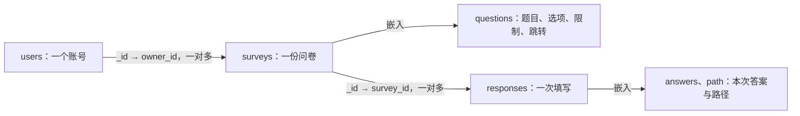

# 问卷系统数据库设计

默认数据库名为 `survey_system`，通过 `MONGODB_DB_NAME` 环境变量调整。连接地址由 `MONGODB_URI` 指定，默认连接本机 27017 端口。

## 集合划分

| 集合 | 一份文档代表什么 | 当前状态 |
| --- | --- | --- |
| users | 一个用户账号 | 字段、校验和唯一索引已实现 |
| surveys | 一份问卷 | 草稿创建、题目追加、归属查询、结构校验及索引已实现 |
| responses | 一次填写（进度或正式提交） | 字段、结构校验、进度保存与提交索引已实现 |

问卷通过 `owner_id` 引用用户的 `_id`，回答通过 `survey_id` 引用问卷。用户文档保持固定大小，问卷与提交数量可以分别增长；题目嵌入问卷文档，以便一起读取。回答数组嵌入每次填写文档，`state` 区分 draft 和 submitted；统计只能读取 submitted。完整字段及索引见 [填写与答案保存说明](填写与答案保存说明.md)。



集合关系由应用维护，MongoDB不会自动执行外键检查或级联删除。当前没有删除用户/问卷的业务接口；未来增加删除时须明确关联回答的保留与清理政策。

## 为什么采用这三个集合

账号、问卷、一次填写是不同的读写单位：登录主要读users，管理读取某个创建者的surveys，保存进度只更新本次responses，统计按survey_id读取正式回答。因此将它们分开，可避免一个用户或问卷文档随填写次数持续增长，也便于为不同查询建立索引。

题目、选项、校验和跳转规则属于同一份问卷，通常一起展示和校验，且当前发布后锁定；嵌入questions可以一次读取完整配置，草稿追加和规则替换也落在同一个文档内。若拆成题目表、选项表、限制表和规则表，当前每次填写都需额外组装这些信息。

一份回答的答案和实际路径也总是一起恢复、校验和提交，所以嵌入responses：一次原子更新即可保存answers、path、当前题和version。将每题答案分别存成独立文档会增加协调进度和整份提交状态的工作。不同次填写仍分成独立文档，避免把所有回答嵌入问卷造成单个文档持续增长及写入竞争。

users与surveys、surveys与responses使用引用，是因为二者有独立生命周期且数量可能增长。题目和选项用稳定编号引用，答案不存易变的题目位置或选项文字。

## 为什么没有按关系表逐表照搬

关系数据库同样可以实现本系统，并非技术上不能使用。课程要求采用MongoDB，而当前访问方式也适合按文档聚合保存；因此没有把关系表结构原样搬成多个集合。

| 设计点 | 关系表方案的常见组织 | 本项目选择与代价 |
| --- | --- | --- |
| 多种题型 | questions公共表加各题型限制表，或多个可空列 | 每题嵌套对应validation，JSON Schema按题型限定字段；仍需应用检查跨字段业务约束 |
| 题目选项和跳转 | options、rules及条件项等子表，查询后组装 | 嵌入一份问卷，读取与校验集中；修改整卷配置会涉及较大文档 |
| 一次填写 | response主表及多行answers，通过事务协调 | answers和path嵌入一次填写，可做单文档原子更新；大规模按题分析仍需展开或聚合 |
| 账号与归属 | 外键及联表查询 | ObjectId引用，应用主动检查用户和归属，没有数据库外键自动保证 |
| 多表/多集合一致性 | 可使用关系事务 | 当前单机采用单文档条件更新、版本比较及唯一索引；跨集合准入与回答写入有明确故障边界 |

MongoDB的嵌套文档、数组和按字段校验契合“问卷带不同题型配置”“一次填写带实际答案路径”的形状。灵活结构不代表没有约束：本项目对三集合启用strict/error校验，拒绝未知字段，并对跨字段与引用规则额外校验。

题目配置也承担规则存储：必答、多选数量、文本长度、数字范围及jump_rules都嵌入surveys.questions。程序读取这些配置并调用通用校验、跳转函数，修改具体问卷规则无需改Python代码；支持的题型及运算符仍由程序定义。报告第三章集中说明了集合、引用、冗余和配置驱动的取舍，详见[项目完成报告](项目完成报告.md)。

这是一份面向当前第一阶段访问模式的取舍，不声称MongoDB一定比关系数据库更快。若以后题目规模很大、需要频繁独立编辑或跨问卷复用题库，应重新评估拆分与版本设计；大量回答统计也应通过实测评估缓存或增量汇总。

## surveys 字段

| 字段 | BSON类型 | 含义及约束 |
| --- | --- | --- |
| _id | objectId | 问卷编号，形成固定分享链接 |
| owner_id | objectId | 创建者users._id，由登录态确定 |
| title | string | 去首尾空白，1～200字符 |
| description | string | 去首尾空白，最多5000字符，可空 |
| status | string枚举 | draft、published、closed |
| is_anonymous | bool | 是否匿名收集 |
| allow_repeat | bool | 是否允许一个账号再次正式填写 |
| questions | array | 有序的嵌入题目列表，草稿可为空 |
| created_at | date | UTC创建时间 |
| updated_at | date | UTC最近配置保存或提交准入时间 |
| published_at | date或null | 首次发布时间，未发布为null |
| deadline | date或null | UTC截止时间，null表示不限制 |

## 问卷与嵌入题目

问卷包含 `_id`、`owner_id`、`title`、`description`、`status`、`is_anonymous`、`allow_repeat`、`questions`、`created_at`、`updated_at`、`published_at`、`deadline`。创建时为draft，发布时间与截止时间初始为null；发布后为published并记录UTC发布时间，关闭后为closed。deadline为UTC日期或null；“已截止”由当前时间实时推导，不增加存储状态。完整字段与题型结构由 `survey_schema.py` 中的 `SURVEY_VALIDATOR` 校验。生命周期及并发规则见 [发布与分享说明](发布与分享说明.md)。

标题去首尾空白后为1～200字符，说明最多5000字符。归属和时间由服务器设置。问卷查询始终带 owner_id；索引 `owner_created_at` 为 owner_id升序、created_at倒序、_id倒序。追加题目使用带所有权、草稿状态和题目编号条件的原子更新，避免并发覆盖。字段类型由数据库检查，跨字段业务规则由应用层检查；详细数据流见 [问卷创建与保存说明](问卷创建与保存说明.md)。

`questions.py` 已提供 `build_question`、`validate_question`、`validate_questions`、`validate_answer`。题目结构、各题型配置、空答案与边界规则见 [题型与校验说明](题型与校验说明.md)。实际数据库测试已验证题目嵌入数组保存后可以重新读取并校验，包括 64 位整数；测试文档只写入独立临时数据库。

| 题目字段 | 内容 |
| --- | --- |
| id、title、required | 稳定题目编号、题干、必答开关 |
| type | single_choice、multiple_choice或fill_blank |
| options | 仅选择题，数组元素为id与text，至少两个 |
| input_type | 仅填空题，text或number |
| validation | 单选为空对象；多选min_choices/max_choices；文本min_length/max_length；数字min_value/max_value/integer_only |
| jump_rules | 数组；每项包含condition的operator/value和target_question_id，顺序为优先级 |

数字填空示例（这是questions数组中的一个完整元素，不是独立集合）：

```json
{
  "id": "q_age", "type": "fill_blank", "input_type": "number",
  "title": "年龄（请使用阿拉伯数字回答）", "required": true,
  "validation": {"min_value": 0, "max_value": 120, "integer_only": true},
  "jump_rules": []
}
```

上下限null表示不限制；多选和文本数量为非负整数，数字为有限数值。跨字段上下限、选项引用、前向跳转及唯一题目编号由应用验证。仅改题目文字不会自动改变input_type，数字平均值和强制格式由明确题型决定。

## responses 字段

| 字段 | BSON类型 | 含义及约束 |
| --- | --- | --- |
| _id | objectId | 一次填写及幂等回执编号 |
| survey_id | objectId | 引用surveys._id |
| respondent_key | string | 按问卷隔离的64位十六进制HMAC标识 |
| user_id | objectId或null | 实名关联账号；匿名必须为null |
| is_anonymous | bool | 开始填写时复制问卷开关 |
| allow_repeat | bool | 开始填写时复制，供部分唯一索引过滤 |
| state | string枚举 | draft或submitted |
| question_revision | string | 题目/规则配置的64位十六进制SHA-256摘要 |
| version | int或long | 非负整数，保存、返回和首次提交时递增 |
| answers | array | 有序的question_id/value对象；值为选项编号、数组、文本、数字或null |
| path | array | 实际路径题目编号，不重复；草稿可能只包含已保存前缀 |
| current_question_id | string或null | 当前填写题；确认页及正式提交为null |
| created_at | date | UTC开始填写时间 |
| submitted_at | date或null | UTC提交准入时间，draft为null |

response_schema.py同时约束匿名开关与user_id、提交状态与日期/当前题的配合。应用层仍需重算path并校验答案与对应问卷一致，不依赖BSON类型就认定业务正确。详情、并发及故障边界见 [填写与答案保存说明](填写与答案保存说明.md)。

## 索引与查询

第一阶段三集合保留；第二阶段另有question_items、question_versions、question_banks，共六集合，均有MongoDB默认的_id_唯一索引。下表是init-db另外创建的全部业务索引；箭头↑表示升序，↓表示降序。

| 集合 | 索引名 | 键顺序 | 唯一性及用途 |
| --- | --- | --- | --- |
| users | username_unique | username↑ | 唯一，规范化用户名登录及防重复注册 |
| surveys | owner_created_at | owner_id↑、created_at↓、_id↓ | 当前账号问卷列表及稳定倒序 |
| responses | one_submission_per_user | survey_id↑、respondent_key↑ | 部分唯一，仅state=submitted且allow_repeat=false；防止重复正式提交 |
| responses | respondent_progress | survey_id↑、respondent_key↑、state↑、created_at↓ | 查本人最新草稿或已提交记录 |
| responses | survey_submissions | survey_id↑、state↑、submitted_at↓ | 按问卷统计及按提交时间读取答案 |
| surveys | owner_version_uses | owner_id↑、questions.source.version_id↑ | 查询本人问卷中的固定版本引用 |
| question_items | item_owner_created | owner_id↑、created_at↓ | 本人题目列表 |
| question_items | item_shared_created | shared_with↑、created_at↓ | 定向共享题目列表 |
| question_versions | question_version_unique | question_id↑、number↑ | 唯一，防止同题版本号重复 |
| question_banks | bank_owner_created | owner_id↑、created_at↓ | 本人题库列表 |

填空答案还按_id进行同一提交时间下的稳定排序；不能因为有上述索引就声称整个聚合无需排序。数字分布和按题去重人数也通过聚合计算，没有另建统计集合或缓存。

## 冗余与一致性

responses中的is_anonymous和allow_repeat是有目的的设置快照，前者配合user_id校验身份结构，后者让部分唯一索引仅约束不允许重复的正式回答。question_revision用于检测题目配置变化，不复制题干和选项全文。每次填写保存和提交都会核对快照与现有问卷，外部改配置时拒绝继续，避免两种语义混用。

respondent_key与实名user_id部分相关，但匿名时不能依赖user_id去重；保留统一内部标识使匿名和实名共享权限、防重复和人数逻辑。标识不返回结果页，其密钥必须稳定保存。没有在users中冗余问卷数组，也没有在surveys中缓存回答总数，避免每次提交维护多处计数。

每次回答的答案、路径、状态、时间和version一起写入同一文档。发布和规则保存匹配旧配置，填写更新匹配旧version，防重复由唯一索引兜底。提交准入在surveys、最终状态在responses，二者不是跨集合原子事务，失败后的处理见 [关键逻辑说明](关键逻辑说明.md)。

## users 字段

| 字段 | BSON 类型 | 规则 |
| --- | --- | --- |
| _id | objectId | 后端生成稳定的唯一编号 |
| username | string | 必填，规范化后长 3～30，仅含小写英文字母、数字、下划线 |
| password_hash | string | 必填，保存 Werkzeug 生成的 scrypt 哈希字符串 |
| created_at | date | 后端生成 UTC 时间，存为日期类型 |

当前用户文档固定为这四个字段。MongoDB 使用严格 JSON Schema 校验，拒绝缺失或类型不符的字段，以及额外的明文 `password` 字段。增加字段时应明确更新结构和兼容性测试。

### 用户名处理

`users.normalize_username()` 是唯一的用户名处理入口：

1. 要求输入为字符串。
2. 去除首尾空白。
3. 校验剩余内容为 3～30 个 ASCII 英文字母、数字或下划线。
4. 将英文字母统一转为小写。

例如 `  Alice_01  ` 保存为 `alice_01`。长度在去除首尾空白后计算，内部空白和中文不合法。先检查字符范围再转小写，可避免少数 Unicode 字符转成 ASCII 后被误接受。

文档构建、用户保存与按用户名查询都使用这一函数。注册和登录路由直接调用已有用户层函数，保证处理规则一致。

`username_unique` 是 `username` 的唯一索引，负责拒绝重复名字。应用层可以给出友好提示，但并发注册时仍以数据库约束为准；同名写入会抛出 `DuplicateKeyError`。

### 密码处理

使用 `generate_password_hash(password, method="scrypt")` 生成带随机盐的密码哈希，使用 `check_password_hash()` 验证。相同密码生成的哈希也可以不同。

密码保持原始大小写和空格，当前仅要求非空字符串；长度和复杂度政策尚未确定。代码不保存原始密码，不生成默认账号。数据库检查哈希的 scrypt 格式；该格式检查不能替代真正的哈希计算。

### 时间处理

Python 使用 `datetime.now(timezone.utc)` 生成注册时间，MongoClient 设置 `tz_aware=True`，查询结果保留 UTC 时区信息。BSON Date 精度为毫秒，展示时可以转换为北京时间。

## 初始化与数据保护

通过 `python -m flask --app app:app init-db` 创建三集合、各自校验器及上表全部业务索引。初始化可重复执行，不清空数据。旧版 surveys 集合无校验且为空时补上新规则；上一版要求 jump_rules 全为空的已知严格校验可自动升级为本版规则，保留所有文档；遇到无规则的非空旧集合或其他未知规则时停止并提示数据迁移，不自动覆盖。用户校验规则不同也会停止。

用户集合结构由 `database.py` 中的 `USER_VALIDATOR` 定义，问卷结构由 `survey_schema.py` 定义。网页请求由 `get_request_database()` 获取配置对应的数据库，并在请求结束后关闭连接。账号操作读写 users，问卷服务读取用户归属并读写 surveys；responses 保存填写进度及正式回答。无校验且为空的旧 responses 集合可自动补约束；非空未知旧结构仍需明确迁移，不自动覆盖。

## 容量、性能与后续演进

题目嵌入和答案嵌入受到MongoDB单文档大小上限约束，不能无限添加题目或输入超大答案；当前应用另有64 KiB请求体限制，但多次追加的累计文档大小仍需考虑。没有实现超大问卷拆分、草稿过期清理或答案归档。

统计目前遍历正式回答并执行额外聚合，应用内存不随回答份数保存整份列表，但数据库扫描、分组和排序有成本。所有提交还要更新同一问卷的准入文档，热门问卷可能竞争；并发正确性测试不等于性能压测。扩大规模前应测量实际负载，再评估连接复用、增量统计、数据拆分与事务部署。

第二阶段继续保留三集合和稳定编号；新增字段时明确默认值、校验器升级与旧文档迁移，不静默重建集合。若引入发布后编辑，应先设计问卷版本与旧答案解释方式；不能只改题干/选项而忽略已存答案。备份应同时考虑MongoDB数据及内部身份密钥；代码仓库不包含真实密码、密钥或业务数据库文件。

## 参考资料

- [MongoDB JSON Schema 校验](https://www.mongodb.com/docs/manual/core/schema-validation/specify-json-schema/)
- [MongoDB 唯一索引](https://www.mongodb.com/docs/manual/core/index-unique/)
- [PyMongo 日期和时区](https://www.mongodb.com/docs/languages/python/pymongo-driver/current/data-formats/dates-and-times/)
- [Werkzeug 密码处理](https://werkzeug.palletsprojects.com/en/stable/utils/#module-werkzeug.security)

## question_items 字段

| 字段 | BSON类型 | 含义 |
| --- | --- | --- |
| _id | objectId | MongoDB唯一编号 |
| owner_id | objectId | 创建者，后端确定 |
| name | string | 名称1～200字符 |
| current_version_id | objectId/null | 默认选用的确切版本编号 |
| current_version_number | int/long | 当前默认版本号 |
| next_version | int/long | 版本号分配计数器，可因失败留空号 |
| shared_with | array | 获准使用题目的用户编号数组，不授予答案访问权 |
| forked_from_version_id | objectId/null | 派生来源版本，可空 |
| created_at | date | UTC创建时间 |
| updated_at | date | UTC更新时间 |

## question_versions 字段

| 字段 | BSON类型 | 含义 |
| --- | --- | --- |
| _id | objectId | MongoDB唯一编号 |
| question_id | objectId | 稳定题目身份编号 |
| number | int/long | 同题唯一、递增的版本号 |
| content | object | 题目、选项及限制的固定内容；无跨问卷跳转 |
| parent_version_id | objectId/null | 本次内容派生自哪个版本，可跨题目引用共享来源 |
| previous_version_id | objectId/null | 创建时原默认版本，保留修改过程 |
| restored_from_version_id | objectId/null | 恢复来源，恢复时新建版本 |
| change_note | string | 修改说明，最多500字符 |
| created_by | objectId | 版本作者编号 |
| created_at | date | UTC创建时间 |

## question_banks 字段

| 字段 | BSON类型 | 含义 |
| --- | --- | --- |
| _id | objectId | MongoDB唯一编号 |
| owner_id | objectId | 创建者，后端确定 |
| name | string | 名称1～200字符 |
| description | string | 说明，最多500字符 |
| entries | array | 题目编号与确切版本编号的引用数组，每题一个条目 |
| created_at | date | UTC创建时间 |
| updated_at | date | UTC更新时间 |

## 第二阶段固定版本与兼容

问卷题目可带可选source对象，包含ObjectId类型question_id和version_id；题目正文继续嵌入问卷，避免新版或撤销共享改变旧问卷。导入给问卷实例生成新id，保留版本选项编号；跳转在问卷内独立配置。第一阶段无source的数据继续合法，不自动建立模糊版本关系或重写回答。

初始化只接受已知第一阶段schema的兼容升级，添加可选来源和三个新集合，不覆盖未知校验。版本内容只通过插入新增，恢复复制旧内容形成新版本，关联恢复源及原默认版本。版本号先原子分配、后插入、最后更新默认指针；非事务流程可能留空号或无主版本，指针不会指向尚未插入的内容，较慢的小版本不能覆盖较大版本。
