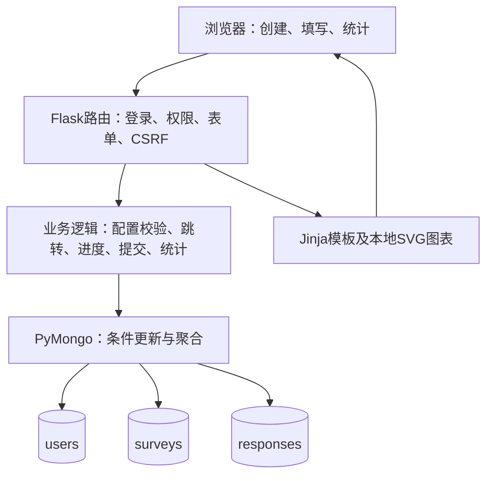

# 基于MongoDB的问卷系统：项目完成报告

GitHub仓库：https://github.com/Beejiaang/mongodb-survey-system

课程：当代数据管理系统｜项目：第一次大作业，第一阶段｜整理日期：2026年10月21日

本报告按原文“七、提交内容／4.项目完成报告”组织，涵盖项目目标、系统设计、MongoDB设计、跳转设计、校验设计、AI使用过程、测试结果、遇到的问题及解决方法。技术内容依据当前代码和测试整理。

## 一、项目目标

本项目实现一个以MongoDB为后端存储的在线问卷系统，完成“账号注册登录—创建问卷—设置题目与规则—发布分享—填写保存—查看统计”的完整流程。核心目标是将不同题型、校验条件和跳转规则保存为可配置数据，使系统按问卷配置执行，而不是把具体问卷逻辑写死在程序中。

第一阶段要求包括用户账号、本人问卷管理、单选/多选/填空题、条件跳转、答案校验、多人填写、匿名与重复填写设置，以及整卷和单题统计。已在此基础上增加图表切换、单选回答人数、数字输入提示及强制格式检查、填写进度恢复、提交幂等和提交材料的一致性验证。

基础需求已拆分为51项业务验收点，详见[需求验收清单](需求验收清单.md)。业务验收点与[测试用例](测试用例.md)是两套不同分类；当前用例为54组自动场景加1组跨设备手工场景。2026年10月22日由用户通过手机热点完成N01实际样本的跨设备核心流程，数据库和关闭后的HTTP检查一致，S07更新为通过；未执行的手工项目及未归档证据见测试记录。本文只总结第一阶段，不预先宣称第二阶段需求变更已完成。

## 二、系统设计

### 2.1 技术结构

后端使用Python、Flask和PyMongo；页面由Jinja模板生成，使用HTML表单与少量JavaScript。MongoDB负责持久化和结构约束，本地SVG脚本提供统计图表，不依赖外部图表CDN。项目使用普通分层代码组织，没有引入完整问卷平台框架。

| 模块 | 主要代码 | 职责 |
| --- | --- | --- |
| 账号 | app.py、auth.py、users.py | 应用配置、用户名规范化、哈希密码、登录会话与CSRF |
| 问卷管理 | survey_views.py、surveys.py | 创建、列表、题目追加、规则配置、发布、截止与关闭 |
| 校验及跳转 | questions.py、numeric_input.py、jumps.py | 题目配置、答案校验、数字解析、条件判断和路径计算 |
| 填写 | response_views.py、responses.py | 保存与恢复进度、返回修改、版本检查、准入、提交回执 |
| 统计 | result_views.py、survey_results.py | 整卷及单题计数、人数、平均值、分布与答案分页 |
| 数据约束 | database.py、survey_schema.py、response_schema.py | 三集合初始化、JSON Schema、索引与已知旧结构升级 |

### 2.2 角色、权限与流程

用户登录后可以创建自己的问卷，同时也可以填写他人已发布的问卷。创建者权限由问卷的owner_id决定，没有额外管理员角色。问卷管理和统计查询同时限定问卷ID与当前用户ID，防止仅凭链接查看或修改他人数据。

创建者先保存草稿，再逐题添加题型、限制和跳转；选择题默认A/B两行并用加号继续添加，填空统一入口选择文字或数字。发布前检查整卷合法性，发布后锁定题目。分享入口为 `/survey/<survey_id>`，接收者先登录，入口只提供退出及开始/继续填写，不预览整卷题目；登录成功返回原问卷。截止时间按北京时间输入、UTC存储；到达截止即停止接受新的填写操作。延长已到期问卷的截止时间可恢复入口，手动关闭的问卷当前不能重新发布。

填写者每次点击“保存并继续”后，答案与进度才写入数据库。系统先校验，再决定下一题；最后显示确认页，正式提交后生成本人回执。刷新或重新登录可以恢复已保存进度，未保存的输入不保证恢复。修改前题并继续时会清除后续旧答案，避免隐藏分支的答案进入统计。

### 2.3 保存与并发控制

每次填写单独保存为responses文档，不同填写者互不覆盖。保存时同时匹配draft状态和旧version，成功后递增version；两个页面提交同一旧版本时只有一个成功，其余请求得到冲突提示。禁止重复填写时，部分唯一索引限制同账号同问卷只能有一份正式回答；允许重复时可创建新的填写记录。同一已提交记录再次提交返回原回执，不重复入库。

正式提交前重算完整路径，并在问卷文档上原子检查发布状态、配置与数据库时间的截止条件，然后更新回答文档。当前不是跨集合事务：已准入的请求可在关闭之后完成写入，准入后回答写入失败仍保留为草稿；不能描述为两个集合一起原子提交。详细时序和故障边界见[关键逻辑说明](关键逻辑说明.md)。

## 三、MongoDB设计

### 3.1 集合与关系

| 集合 | 文档含义 | 关键内容 |
| --- | --- | --- |
| users | 一个账号 | _id、username、password_hash、created_at，固定四字段 |
| surveys | 一份问卷 | owner_id、标题说明、状态、匿名/重复开关、questions、创建/更新时间、发布时间与截止时间 |
| responses | 一次填写 | survey_id、内部回答者标识、匿名身份、设置快照、状态、版本、answers、path、当前题及时间 |

surveys.owner_id引用users._id；responses.survey_id引用surveys._id。题目、选项、限制、跳转嵌入surveys.questions，一次填写的答案与实际路径嵌入responses。题目和选项均使用稳定编号，答案引用编号而不是题目位置或显示文字。

### 3.2 嵌入与引用的取舍

一次填写需要读取完整问卷配置，题目也属于同一份问卷，因此将题目嵌入可以减少组装查询，草稿追加和规则修改可在单文档内完成。答案和进度总是一起恢复和提交，嵌入同一responses文档便于原子保存。

账号、问卷和填写记录具有独立生命周期，数量会分别增长，因此使用三个集合引用关联。没有把所有回答嵌入问卷，避免一份问卷随着填写次数不断膨胀。MongoDB不自动提供外键检查，这些关联和所有权由应用验证。

与关系表方案相比，本设计适合保存不同题型的嵌套配置，减少题目、选项和规则的拆表组装，但也承担跨字段校验、引用一致性和大文档演进的责任。选择MongoDB既满足课程要求，也适应当前读取完整问卷、更新单次填写的访问方式；没有据此假定其性能必然优于关系数据库。

### 3.3 约束与索引

三集合启用严格JSON Schema校验，限制必填字段、BSON类型、枚举及未知字段；应用额外检查上下界、选项引用、跳转目标和完整路径。users只存带随机盐的scrypt密码哈希，数据库拒绝额外的明文password字段。

除默认_id索引外，五个业务索引用于：username唯一注册；按owner_id与创建时间查询问卷；禁止重复时约束正式提交；查某回答者的填写进度；按问卷与状态读取正式回答。部分唯一索引只作用于 `state=submitted且allow_repeat=false`，草稿和允许重复的回答不受同样限制。完整字段、键顺序及示例见[数据库设计](数据库设计.md)。

匿名问卷仍要求登录，但responses.user_id为空；用HMAC-SHA256生成按问卷隔离的respondent_key，以支持恢复进度、防重复和人数统计。结果页面不暴露该标识。它不是对服务器管理员不可关联的完全匿名，密钥需要持久保存。

初始化命令可重复执行且不清空数据。已知可兼容旧schema可升级，未知非空旧结构停止并要求迁移。嵌入数据受单文档大小限制；后续若允许已发布题目编辑，应先设计版本及历史答案解释方式，不能直接覆盖配置。

## 四、跳转设计

规则保存在每道题的jump_rules数组中，每条由condition和target_question_id组成。当前只支持基于当前一题的单独条件，规则从上到下判断，首条命中生效；不命中或选答留空按题目顺序前进。目标必须是同一问卷内后面的题，从配置层面排除自跳和循环。

| 题型 | 支持条件 | 例子 |
| --- | --- | --- |
| 单选 | equals | 选择A时跳至后面的指定题 |
| 多选 | contains_all | 指定A、B时，AB或ABC都命中 |
| 多选 | equals_set | 指定A、B时，只允许AB，BA等价，ABC不命中 |
| 数字填空 | eq、lt、lte、gt、gte、between | 年龄小于18或处于指定闭区间时跳转 |

两条规则同时命中时使用第一条，创建者可以在页面调整顺序、删除和试算。文本填空当前没有跳转条件编辑，最后一题无需跳转规则。

执行时先校验当前答案，再计算下一题。提交时从首题重新推导实际路径，只校验实际到达的题；被跳过的必答题不要求回答，其旧答案也不进入正式结果。明确留空的选答题与尚未回答的题分开处理，避免错误结束或错误强制回答。

例如第一题选择A直接到第三题，则第二题即使必答也可被跳过；返回第一题改为不跳转后，第二题重新进入路径，必须按配置回答。跳转配置用修订摘要保护，过期表单不能覆盖最新规则。配置、执行和回归案例见[跳转规则说明](跳转规则说明.md)及测试用例J01～J06。

## 五、校验设计

填写页不再常驻显示数字上下限和格式说明，创建者仍可设置这些限制，系统也会继续检查答案。输入不符合要求时，页面会说明原因。题目中的“（请使用阿拉伯数字回答）”用较小的浅绿色标签显示，方便与题目正文区分。这个调整只影响显示，存储的标题和数字校验规则保持原样。

采用创建时配置校验、填写时浏览器提示和服务端强制校验、存储时schema约束。浏览器检查用于及时反馈，服务端检查决定是否接受，不能通过绕过前端直接写入不合法答案。

| 对象 | 规则与边界 |
| --- | --- |
| 用户名 | 去首尾空白，长度3～30，仅ASCII字母/数字/下划线，统一小写；注册登录共用规则 |
| 单选 | 有且只有一个有效选项ID；必答题不能留空 |
| 多选 | 选项ID有效且不重复，数量满足最少/最多；二者相等表示恰好选指定数量 |
| 文本填空 | 按Unicode码点计数，满足最少/最多字符限制，非空内容原样保存 |
| 数字填空 | ASCII阿拉伯数字格式，支持符号、小数和科学计数法；必须有限，符合范围、整数要求与BSON限制 |
| 配置 | 上下界合理、题目/选项ID唯一、跳转引用有效、必答条件可满足 |

选答允许留空，但填写后仍需满足最小长度或数量；数字0是有效值，不能被当作空。例如多选设2～3项，1/4项不通过，2/3项通过；文本设2～3字符，两端都接受；年龄设0～120整数，0和120通过，负数、121、非整数不通过。

创建者可一键附加“请使用阿拉伯数字回答”，文本题同时转换为数字题；重复点击不反复添加，按钮本身不保存题目。实际校验由数字题型决定，不依赖题干出现某句话。全角１８、中文十八、18岁、NaN等即使直接POST也拒绝。非法答案会保留输入和提示，数据库进度与当前题不前进。

## 六、AI使用过程

### 6.1 使用工具与协作方法

主要工具为Codex，配合终端、Git、GitHub连接和浏览器检查。协作按“明确本步范围—设计—实现—测试—提交—汇报”推进，每次改动要求更新相关测试并创建Git commit。阶段原始提示词、生成内容、修改和验证见[AI使用日志](AI使用日志.md)。早期部分工作使用了子代理，后续是否使用均按日志记录，不能统一写成全程独立完成。

### 6.2 AI帮了什么

| 用户实际提出的要求 | AI生成或完成的内容 | 采用与调整情况 |
| --- | --- | --- |
| 三集合、users四字段、用户名规范化、密码哈希 | 数据结构、初始化、账号函数与测试 | 按用户明确规则落地，之后接入注册登录页面 |
| 单选、多选、填空，注意文档中的限制 | 题目配置、数量/字数/数字校验和网页表单 | 复用同一配置驱动保存、填写和校验，补充BSON边界 |
| 单独条件跳转，区分多选至少包含与恰好包含 | 条件结构、页面配置、优先级、试算与路径计算 | 明确首条命中、只向后跳，接入实际填写 |
| 填写保存、汇总、自由切换图表 | responses流程、统计页面、本地SVG与测试 | 增加返回修改、幂等、权限、分页及图表失败回退 |
| 单选总人数、数字提示和强制检查 | 人数去重、数字提示按钮、格式解析与回归 | 区分人数与份数，防止仅靠提示文字要求数字 |
| 创建和填写页面使用起来不方便，分享入口提前显示整卷 | 逐行选项、统一填空入口、精简分享页和复制链接的兼容处理 | 按我的反馈调整页面，数字提示最后加上中文括号；手机复制效果仍待实际确认 |
| 按提交要求逐项验收 | 需求映射、四份说明、测试用例与本报告 | 对照代码和运行结果整理，个人陈述由本人补充 |

### 6.3 AI做错了什么及如何纠正

已有日志记录了实际错误和修正：填写提交初版在同记录并发完成时曾误报重复，随后修正幂等判断并加入确定性回归；静态资源测试曾未关闭响应而产生ResourceWarning，改为正确释放资源并以警告作为错误回归；数字提示新增测试曾在题目尚未添加完时携带跳转配置而触发既有保护，随后修正测试样例的构造顺序。

BSON大整数读取为Int64的兼容性在实现检查中被发现，校验调整为接受整数子类并排除布尔值。数据库未启动或受限环境无法连接造成的测试失败属于环境问题，日志保留失败原因，在确认并恢复连接后重跑，没有把失败改成跳过来宣称通过。

试用页面时，我发现选择题要在一个文本框里按行填写选项，添加起来不够直观，分享入口也直接列出了全部题目。我要求AI把选项改成逐行输入，用加号继续添加，并去掉分享入口的题目预览。复制链接按钮也出现了点击后没有反应的情况。检查代码后发现，原按钮只用了现代剪贴板接口，在局域网HTTP环境下可能不可用；AI补充了兼容复制，仍失败时提示手动复制。手机上的实际复制效果还需要重试确认。

上述代码与测试修正由AI完成，不能自动归为学生本人修改。AI给出的结果需要通过需求逐项比对、边界测试和实际运行确认，测试通过也不代表所有部署条件和性能范围已验证。

### 6.4 自己设计了什么

数据存储方面，我参与确定了users、surveys、responses三个集合，以及用户集合的四个字段。我对这一划分的理解是，用户、问卷和每次填写分别保存，便于管理它们之间的关系，也能让同一份问卷保存多人的回答。
用户名规则方面，我明确要求长度为3～30个字符，支持英文字母、数字和下划线，去除首尾空格并统一转为小写，注册和登录采用相同规则。这样可以减少输入差异造成的登录问题，也避免仅大小写不同的重复用户名。
跳转规则方面，我决定先实现单题条件，不加入组合条件，并要求明确区分多选题的两种情况：“至少包含指定选项”和“恰好选择指定选项”。例如指定A、B时，选择A、B、C可以满足前一种条件，但不满足后一种条件。我认为这一区分直接影响填写路径，需要在创建问卷时表达清楚。
统计展示方面，我先要求展示数据，再增加可自由切换的图表。在核对过程中，我还要求补充单选题总回答人数，以及数字题的输入提示和强制检查。我也关注到人数和提交份数的区别：允许重复填写时，同一账号可以产生多份回答，因此两者应分别统计。
其中我考虑最多的是跳转规则方面，在面对ai对面对跳转规则的情况时产生语义理解不足，我便提出先完成简单的单独判断条件，后引入组合条件的方案。

### 6.5 自己改了什么

在检查AI生成的功能和说明时，我发现了一些需要完善的地方，并提出了具体修改要求。代码修改主要由AI完成，我主要负责指出问题、明确预期效果，并核对修改结果。

例如，创建选择题时，原来需要在一个文本框里按行输入选项。我觉得这样不够方便，就要求默认显示A、B两行，在字母右边填写内容，点击下面的加号再出现C、D等选项。填空题也不用分成两个入口，放在一起后再选择文字或数字就可以。

填写页面上，数字格式和最大、最小值的说明比较多，我要求删去这些常驻的小字，校验继续保留。“请使用阿拉伯数字回答”与题目正文混在一起时不容易区分，我先让AI调整样式，之后又要求加上括号，最后显示为“（请使用阿拉伯数字回答）”。

我还指出，别人通过链接进入问卷时，不应该先看到所有题目，入口只需要退出和开始或继续填写。我也反馈了复制链接按钮似乎没有反应的问题，让AI检查并补充兼容处理。这个按钮在手机上是否能正常复制，还需要实际确认。

查看统计页面时，我又觉得文本填空的多种图表没有必要，要求删掉这部分，只保留回答数量和填写内容列表。

### 6.6 AI使用反思

这次项目的代码实现和修复主要由AI完成，测试和文档也有不少借助了它的帮助。我主要负责确定需求，发现不符合预期的地方，再提出修改要求。AI回复“已经完成”以后，我还是要去看实际页面和结果，确认它对要求的理解是否和我一致。

跳转规则给我的印象比较深。多选题“至少包含指定选项”和“恰好选择指定选项”只差几个字，实际填写时却会走不同的路径。比如指定A、B，选择A、B、C能满足前一种条件，却不能满足后一种。如果只说“按多选结果跳转”，AI就可能按另一种理解去做。所以我选择先完成单题条件，暂时不加组合条件，把现有规则说清楚。以后描述类似功能时，我会直接给出回答的例子，说明哪些回答应该跳转，哪些应该按顺序继续。

单选题的总回答人数也是后来核对时补上的。同一个账号可以提交多份回答时，人数和份数就会不同，需要分别统计。数字题则让我注意到，页面上有提示文字，还要检查它是否真的执行了限制。我提出一键添加“请使用阿拉伯数字回答”，同时要求强制检查输入。检查这类功能时，我需要看看不合要求的内容能不能提交，以及上下限这些边界是否有效。

并发提交误判、测试资源未关闭等问题，是AI在检查和测试中发现并修复的。这些实现我还需要继续学习，尤其是MongoDB约束、版本检查和并发提交的处理过程。遇到看不懂的代码，我也需要追问原因，再结合测试去理解。

以后再用AI协助开发，我会先写清楚规则和几组典型的输入输出，再分步骤实现和检查。每个阶段保留Git提交，代码有变化时同步更新测试和文档，后面查问题或回退时也方便一些。

## 七、测试结果

文本填空不再提供图表和展示方式菜单，保留回答计数与分页内容；单选、多选题仍可切换图表；数字题仅保留分布条形图与数据表格，平均值和原始答案列表继续显示。

测试按原文六类组织，并覆盖额外功能。当前55组场景含33组基础功能、14组扩展功能、6组前端脚本、1组完整链路和1组按实际样本通过的真实跨设备手工核心流程；每组记录前置条件、步骤、输入、预期、实际结果与代码定位，详见[测试用例与验收结果](测试用例.md)。

后端采用unittest，业务集成通过Flask测试客户端访问真实路由并读写真正的MongoDB；测试创建随机隔离库，结束后清理，不写业务库。前端使用Node内置测试运行器；图表事件和分享测试使用真实业务脚本及最小DOM/Clipboard替身，不冒称真实浏览器验收。

| 验证批次 | 范围 | 实际结果 |
| --- | --- | --- |
| 2026年10月20日基础需求验收 | 51项业务验收点、当次190项Python测试 | 通过，保留[第一阶段验收报告](第一阶段验收报告.md)及对应历史证据 |
| 2026年10月21日测试用例整理 | 210项Python、14项JavaScript | 全部通过，分别43.283秒、157.865毫秒；原始日志见[Python记录](验收证据/测试用例-python.txt)、[JS记录](验收证据/测试用例-javascript.tap) |
| 2026年10月21日本报告交付复核 | 211项Python、14项JavaScript | 全部通过，分别41.396秒、140.0958毫秒，无失败、错误或跳过；[Python日志](验收证据/项目报告-python.txt)、[JS日志](验收证据/项目报告-javascript.tap) |
| 2026年10月21日跨设备用例补充复核 | 211项Python、14项JavaScript | 自动回归全部通过，分别55.434秒、261.9353毫秒；[Python日志](验收证据/跨设备用例-python.txt)、[JS日志](验收证据/跨设备用例-javascript.tap)。N01真实第二设备验收当时待执行 |
| 2026年10月22日界面优化回归 | 214项Python、16项JavaScript | [Python日志](验收证据/界面优化-python.txt)、[JS日志](验收证据/界面优化-javascript.tap)；全部通过（45.891秒、147.3263毫秒），覆盖逐行选项、统一填空、精简分享入口与复制降级；N01仍待手工完成 |
| 2026年10月22日数字提示样式及括号调整 | 每轮21项问卷页面集成测试、7项文档测试 | 两轮相关测试均通过，检查提示标签及括号，并继续验证数字格式、保存和平均值；没有重新运行完整套件，过程见[测试说明](测试说明.md) |
| 2026年10月22日移除文本题图表 | 214项Python、16项JavaScript | 完整回归通过；[Python日志](验收证据/文本统计-python.txt)、[JS日志](验收证据/文本统计-javascript.tap)。文本题只保留计数和分页原文，其他题型图表继续提供 |
| 2026年10月22日精简数字图表 | 214项Python、16项JavaScript | 完整回归通过；[Python日志](验收证据/数字图表-python.txt)、[JS日志](验收证据/数字图表-javascript.tap)。数字题移除分布柱状图和频数折线图，保留条形、表格及答案 |
| 2026年10月22日真实手机跨设备验收 | N01实际配置与两份样本 | 用户逐步确认手机操作；两份回答保存、刷新不重复、统计及关闭检查一致，平均7.50；[实测证据](验收证据/N01-跨设备实测.json)。非法数字与上下限手工检查未执行，手机截图未归档 |

已知样本的统计断言包括：正式提交4份；单选有效3份，选项A/B/C为2/1/0，占比66.7%/33.3%/0%；多选有效2份，A/B/C为1/2/0；数字0、10、20的平均值10.00。增加第二个账号后，单选总回答人数2而有效回答4份，验证人数与重复提交份数分开计算。

完整网页业务链覆盖注册、创建、配置三类跳转、发布、三条路径填写、提交、统计和关闭；年龄16/20/30的平均值22.00。有限并发用例检查不同填写者隔离、同记录幂等、禁止重复的唯一约束，以及关闭/截止与提交准入的竞争。

报告最初基于本地提交e00dc00整理，2026年10月22日补充界面优化及对应回归记录；pip check通过，交付前执行Git差异检查。测试环境为Windows、Python 3.12.10、MongoDB 8.0.22，JS测试使用Node v24.18.0。复现命令见[README](../README.md)和测试用例。历史浏览器检查记录在[测试说明](测试说明.md)，本报告整理不重复计算为新浏览器验收。没有开展百人/千人压力、长期运行或完整跨浏览器矩阵测试。N01已由用户在提供热点的手机上实际访问并完成两账号提交，电脑连接该热点。用户确认汇总与文本内容正确、关闭后入口显示关闭；数据库保留两份四题回答，数字6和9的平均值7.50，关闭后GET入口与有效表单POST开始均为410，创建者统计仍为200。本次文本和数字题未设上下限，也没有执行手机端非法数字负例；截图、手机型号及浏览器名称未收集，不能把这些项目记为手工通过。

后续另建手工校验补测问卷，已通过中文数字“十八”的格式拦截、18.5的整数限制、-1低于下限和121高于上限检查，截图与数据库未推进的状态一致，见[补测记录](验收证据/手工校验补测/执行记录.json)。用户随后确认输入0后进入第二题，数据库保存数值0、草稿version=1，下限边界检查通过，本项未提供截图。用户返回第一题改填120后再次进入第二题，数据库数值更新为120、草稿version=3，上限边界也通过（本项无截图）。两端边界均已验证。用户在文本题输入单字“好”，反馈“答案低于最小限制”；数据库仍为version=3、未保存文本，最少字数拦截通过（本项无截图）。用户再输入21字符123456789012345678901，反馈“超过最大限制”，数据库进度仍未推进且文本未保存，超长拦截通过（本项无截图）。2字、20字边界仍待补测，整组文本长度检查尚未完成。

## 八、遇到的问题

| 问题 | 具体表现或风险 | 来源 |
| --- | --- | --- |
| BSON与Python类型差异 | Int64读回后若仅检查精确int类型，会错误拒绝合法整数 | 题型开发时实现检查 |
| 并发重复提交 | 一个请求读到草稿后，另一请求已经提交，前者可能错误返回重复错误 | 填写模块首轮新增测试 |
| 修改前题后的旧答案 | 跳转分支改变后旧答案可能留在结果中，影响必答校验和统计 | 填写与跳转设计需要处理的边界 |
| 截止检查的时间差 | 只在页面或第一次读取时检查，可能在真正提交前已关闭/到期 | 发布与提交的一致性边界 |
| 数字格式与统计口径 | 全角/文字数字、0被当空、大整数精度、人数与份数混淆 | 数字校验、平均值和人数扩展需求 |
| 页面使用与分享 | 选项添加不够直观，分享页提前展示整卷；复制按钮在局域网HTTP环境中可能不可用 | 用户试用反馈及代码检查 |
| 测试资源和环境 | 静态响应未释放，或MongoDB未启动/连接受限造成失败 | AI使用日志中的真实验证记录 |
| 材料与实现可能不同步 | 功能扩展后旧测试数、路由和字段说明可能失效 | 提交材料整理时的维护问题 |

表中区分了实际发现的错误和设计中处理的风险，不把每一种潜在问题都写成已发生事故。

## 九、如何解决

| 对应问题 | 解决方法 | 验证方式 |
| --- | --- | --- |
| BSON类型差异 | 接受合法整数子类，显式排除布尔值，检查BSON范围 | BSON往返及Int64边界测试 |
| 并发重复提交 | 重新识别已提交同记录并返回原回执；不同记录用部分唯一索引防重复 | 并发提交及确定性时序回归 |
| 旧答案残留 | 修改前题并继续时只保留前缀，重算路径，清除后续答案 | 返回修改、跳过必答和统计排除测试 |
| 截止时序 | 数据库时间和问卷单文档原子准入检查，明确准入后写入的故障边界 | 精确截止边界、验证与准入之间关闭/到期测试 |
| 数字与统计语义 | 统一ASCII格式解析、精确整数及平均值处理；按实际路径统计，人数单独去重 | 格式绕过、零值、精度、已知计数样本及图表数据测试 |
| 资源与环境问题 | 释放测试响应，以ResourceWarning作为错误；恢复数据库后完整重跑 | 全套回归及真实MongoDB测试，不跳过故障 |
| 页面使用与分享 | 选项改为逐行添加，填空合并入口；分享页去掉题目预览；复制失败时尝试兼容方式，再提示手动复制 | 测试覆盖选项保存、填空切换、复制成功与失败，以及入口内容和进度隔离；手机复制仍待确认 |
| 材料不同步 | 分别保存历史和当前证据；测试核对路由、字段、索引、示例、用例引用和文档链接 | 文档一致性测试及Git差异检查 |

## 十、完成情况与后续工作

2026年10月22日曾按原文“七、提交内容”核对GitHub，当时版本的代码与schema、配置说明、四份技术文档、测试用例与结果、本报告全文及AI使用日志均已上传。此后新增的界面改动、数字提示样式、文本统计调整和本次文档修改已在本地继续记录，尚未推送GitHub。[项目仓库](https://github.com/Beejiaang/mongodb-survey-system)已设为公开，方便查看和下载提交材料。

第一阶段业务功能、代码配置说明、四份技术文档、测试用例与本报告主体已具备。提交材料入口如下：

后续修改按[协作规则](../AGENTS.md)同步维护测试用例、本报告、测试说明、需求清单及相关设计/使用文档。历史证据保留版本与日期，当前完成状态按最新实测更新；N01按实际样本的用户操作与服务端复核记录结论，原计划未执行项目和未归档截图仍单独保留。

| 材料 | 入口 |
| --- | --- |
| 运行代码与配置 | [README](../README.md)及项目源代码 |
| 系统说明 | [系统说明](系统说明.md) |
| 数据库设计 | [数据库设计](数据库设计.md) |
| 接口与关键逻辑 | [API说明](API说明.md)、[关键逻辑说明](关键逻辑说明.md) |
| 测试用例及结果 | [测试用例](测试用例.md)、[测试说明](测试说明.md) |
| AI协作证据 | [AI使用日志](AI使用日志.md)、本报告第六节 |

当前尚未提供保存后题目编辑/删除、跨题组合条件、答案导出和公网部署。单机环境没有跨集合事务，统计由多次读取完成而非冻结快照；热门问卷准入可能形成写入竞争，大数据量下需要评估连接复用、增量统计与文档规模。这些是明确的实现边界，不以功能测试通过代替性能和部署验证。

第二阶段将根据新的需求继续沿用现有代码、三集合及稳定编号，记录结构调整和兼容性验证。若支持发布后编辑，优先设计问卷版本和旧答案关联；若扩大使用规模，再进行负载、故障恢复、备份及部署验证。
